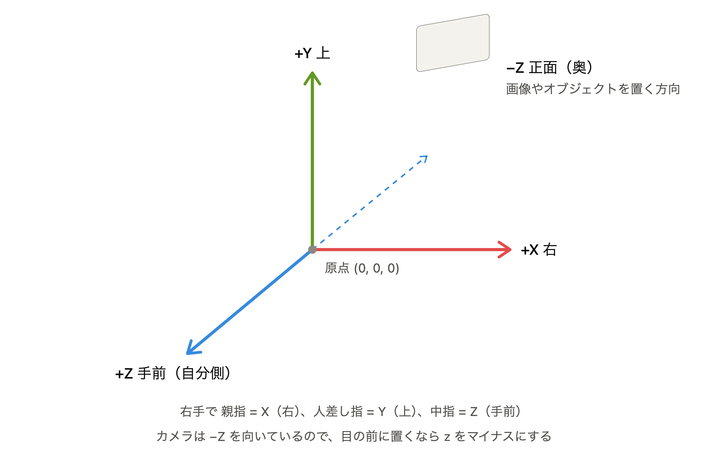

# aframe-vr-image-sample

A-Frame を使って VR 空間に画像を表示するサンプル

## 解説

### 画像を表示する `a-image` について

`index.html` の 22行目、`a-image` では `width`, `height`, `position` という 3 つの属性を指定している。  
それぞれ次の役割がある。

- `width`, `height`: 縦横のサイズを決める
- `position`: 表示位置を決める（x, y, z）

A-Frame の距離単位はメートルなので、この画像は 2m x 2m の大きさで表示される。  
また A-Frame は右手座標系を使用する。つまり正の x 軸は画面右方向に、正の y 軸は画面上方向に、正の z 軸は画面から手前に伸びている。  
そのため `position="0 1.6 -3"` という指定は「左右中央」「床から 1.6m の高さ」「立っている位置から 3m 向こう」に画像を表示する、という意味になる。

参考：[A-Frame Guides -Building a Basic Scene-](https://aframe.io/docs/1.8.0/guides/building-a-basic-scene.html#)

## Links

[A-Frame](https://aframe.io/)

[A-Frame Docs -Introduction-](https://aframe.io/docs/1.8.0/introduction/)
